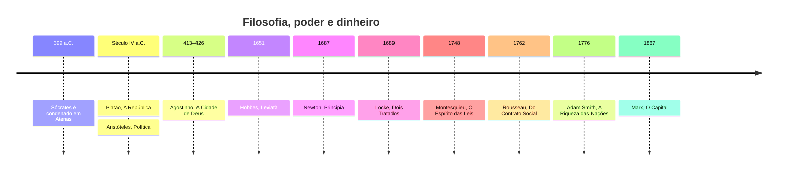

> ***Todo mundo tem opinião sobre política. Quase ninguém tem pergunta.***

*O sono da razão produz monstros. Goya, 1799. Duzentos anos antes das redes sociais.*

Infelizmente, a política virou o hype das últimas semanas.

Todo mundo tem uma opinião.

Todo mundo tem uma explicação.

Todo mundo sabe exatamente quem está certo e quem está errado.

Eu, confesso, não sei.

Não sou especialista em política, história ou filosofia. Quanto mais tento entender esses assuntos, mais percebo o quanto desconheço. E isso me parece mais honesto do que fingir que meia dúzia de vídeos, manchetes e publicações me ensinou a explicar o mundo.

Mas hoje admitir que não sabe virou sinal de fraqueza.

E falar com convicção sobre o que mal conhece virou sinal de inteligência.

## A galinha de Diógenes

Conta-se que, em Atenas, Platão definiu o homem como um *"bípede sem penas"*.

Era Platão. Imagino que pouca gente tenha discutido.

Diógenes discutiu. Diógenes, o cínico, que morava num barril e não devia nada a ninguém, depenou uma galinha, entrou na Academia e apresentou o bicho à plateia:

> ***"Eis o homem de Platão."***

Platão precisou acrescentar à definição: *"com unhas largas"*.

*Diógenes, de John William Waterhouse, 1882. O único homem de Atenas que não precisava de aprovação.*

Por que estou falando disso?

Porque Platão, pelo menos, tinha uma definição para corrigir.

Em ano de eleição, todo mundo grita    . Faça um teste: pergunte o que cada uma dessas palavras significa.

Observe o silêncio.

Ou o xingamento.

## A certeza de quem sabe pouco

Existe até nome para isso: efeito Dunning-Kruger.


Quem sabe pouco sobre um assunto muitas vezes não tem as ferramentas nem para perceber o tamanho do que não sabe. Isso não quer dizer que toda pessoa confiante seja ignorante. Quer dizer que a confiança, sozinha, não prova nada.


*A parábola dos cegos. Pieter Bruegel, o Velho, 1568. Todos seguros do caminho. Repare onde ele termina.*

Na política, isso fica evidente.

Um corte de vídeo de quarenta segundos.

Uma publicação.

Pronto: especialista em economia, história do país, funcionamento das instituições e intenção de todos os envolvidos.

A conclusão chega antes da pesquisa. E, quando a pesquisa aparece, serve só para confirmar o que a pessoa já achava.

As redes ajudam. Uma opinião simples, agressiva e fácil de repetir circula melhor do que uma explicação que exige contexto. Não é preciso entender o assunto para participar. Basta reconhecer as palavras de ordem, escolher um lado e repetir o que o grupo espera ouvir.

Há quem faça isso por convicção. Há quem faça só para não ficar de fora dos trending topics: repete a primeira idiotice que encontra, desde que renda aprovação e não brigue com a própria bolha.

Não se ofenda, leitor. Eu também já fiz isso.

A diferença é que tento admitir.

E tento fazer a mim mesmo a pergunta que quase ninguém faz:


**Como você chegou a essa conclusão?**


## "Política e filosofia não se misturam"

O vídeo que motivou este texto repete essa frase várias vezes. Sempre logo depois de apresentar um filósofo cuja obra prova exatamente o contrário.

A ironia funciona porque a separação é artificial.

### Sócrates

Atenas, lembrada como um dos berços da democracia, julgou Sócrates e o condenou à morte.

A acusação oficial: corromper a juventude e não reconhecer os deuses da cidade.

*A morte de Sócrates. Jacques-Louis David, 1787. Fazer perguntas demais já foi crime capital.*

O método dele era incômodo. Pegava aquilo que as pessoas diziam saber e perguntava: *o que é justiça? O que é coragem? O que é virtude?*

As respostas raramente aguentavam a segunda pergunta.

### Platão e Aristóteles

Platão, aluno de Sócrates, levou essas perguntas para *A República*. Quem deve governar? Como uma cidade deve ser organizada? Como uma democracia pode virar tirania?

Aristóteles, aluno de Platão, escreveu um livro chamado *Política*.

O nome do livro é ***Política***.

É difícil separar filosofia e política quando o filósofo dá esse título à própria obra.

*A Escola de Atenas. Rafael, 1509–1511. No centro, Platão aponta para o céu; Aristóteles, para o chão. A discussão continua.*

### Hobbes, Locke, Rousseau e Montesquieu

*Frontispício do Leviatã, 1651. Olhe de perto: o corpo do soberano é feito de pessoas.*



**Leviatã** 

Colocou a segurança no centro da justificativa para um poder soberano.


**Dois Tratados sobre o Governo** 

Defendeu direitos que nenhum governo deveria violar.


**Do Contrato Social** 

Discutiu a soberania popular.


**O Espírito das Leis** 

Ficou associado à divisão entre Legislativo, Executivo e Judiciário.



Não chegaram à mesma resposta. Mas partiram das mesmas perguntas:


- Quem deve governar?
- Por que devemos obedecer a uma lei?
- Quais direitos um governo não pode retirar?
- Como impedir que o poder seja usado contra quem o concedeu?


Essas não são perguntas decorativas. Elas desenham o país em que você vive.

### E não para aí

Quando Roma foi saqueada, em 410, Agostinho escreveu *A Cidade de Deus* para discutir a relação entre o poder dos homens e o de Deus.

*O saque de Roma pelos visigodos. Joseph-Noël Sylvestre, 1890. O império que parecia eterno.*

Newton chamou sua obra mais famosa de *Princípios Matemáticos da Filosofia Natural*.

Adam Smith, lembrado como pai da economia, era professor de filosofia moral. Marx, de outro lado, ligou religião, direito e política às condições materiais da sociedade.

Não é preciso concordar com nenhum deles para perceber o ponto.

Até o dinheiro tem uma história de ideias.

## Você pode não gostar de política

Ela gosta de você.

Está no seu salário.

No seu imposto.

Na escola, na rua, no posto de saúde.

Aristóteles chamou o ser humano de *animal político* justamente porque ninguém vive sozinho. A gente vive em comunidade, sob regras e instituições, querendo ou não.

A ausência de interesse não elimina essa relação.

Apenas torna mais difícil entender como ela funciona.

## Filosofia embalada para presente

Se a filosofia está misturada com política, religião, ciência e economia, por que ela chega até nós como uma coleção de conselhos?

Porque vende melhor.

*O prestidigitador. Atribuído a Hieronymus Bosch, c. 1502. Enquanto a plateia olha o truque, alguém leva a bolsa.*

| Original | Versão de prateleira |
|---|---|
| Estoicismo | rotina para acordar às cinco da manhã |
| Nietzsche | frase para gente estressada |
| Maquiavel | manual para o chefe ambicioso |
| Platão | inspiração para quem gosta de sonhar |

Não há problema em começar por um vídeo ou uma frase. O problema é confundir a entrada com o assunto inteiro.


O *"conhece-te a ti mesmo"*, inscrito no templo de Delfos, já existia antes de Sócrates. Mas Sócrates não ficou em casa se conhecendo. Levou as perguntas para a praça e confrontou quem se achava dono do saber.


Muitas coisas começam no indivíduo. Quase nada termina nele.

Quando a filosofia vira autoajuda, as perguntas coletivas somem. Em vez de perguntar o que torna uma lei justa, recebemos conselhos para nos adaptar melhor ao mundo como ele está.

É uma redução conveniente.

Resta saber para quem.

## Chegar no meio da conversa

É aqui que entra a história.

Não para decorar datas. Nem para achar que o passado tem resposta pronta para tudo.

Estudar história serve para saber de onde vieram as ideias que a gente defende, que problema elas tentavam resolver e que argumentos já foram usados contra elas.

Quem fala de democracia sem conhecer seus limites usa a palavra sem enxergar o que ela carrega. Quem fala de liberdade sem saber como o conceito foi debatido corre o risco de achar que a própria definição é a única.

Ler um autor sem conhecer as ideias com que ele conversava é como chegar no meio de uma conversa, ouvir uma resposta e achar que entendeu tudo.

Sem saber qual foi a pergunta.

A discussão não começou quando nós chegamos.

## A frase que Sócrates não disse

> ~~*"Só sei que nada sei."*~~

A frase é tão repetida que quase ninguém sabe que Sócrates não a disse desse jeito.


Na *Apologia*, de Platão, o que ele afirma é mais modesto e mais difícil: que **não acha que sabe aquilo que não sabe**.


Repare na ironia, leitor.

Até a frase mais famosa contra a falsa certeza a gente repete sem verificar.

Eu inclusive. Ela estava na primeira versão deste texto.

## Cansaço

Confesso que tudo isso cansa.

Cansa ver gente discutindo conceitos que não define.

Repetindo argumentos que não verificou.

Tratando a política como um campeonato, em que a vitória do próprio time importa mais do que as consequências das decisões.

*Duelo a garrotazos. Goya, 1820–1823. Os dois afundam enquanto brigam. Nenhum dos dois percebe.*

Em muitas conversas, ninguém parece interessado em entender o outro.

Só em responder.

Às vezes dá vontade de fechar todas as abas e silenciar as notificações. Não porque eu tenha encontrado uma resposta, mas porque não vejo como gritar mais alto aproxima alguém dela.

Também faço parte desse mundo. Também erro, também tenho preconceitos e também já repeti ideias sem examiná-las. Não existe um lugar neutro de onde eu possa observar tudo isso de fora.

Conta-se que Diógenes andava pelas ruas em plena luz do dia com uma lanterna acesa.

Perguntavam o que ele fazia.

> ***"Procuro um homem."***

*Diógenes, de Jean-Léon Gérôme, 1860. A lanterna acesa, os cães por companhia.*

Nunca entendi direito essa história.

Até esta eleição.

## No fim

A eleição termina.

As perguntas continuam.

Não sei se estudar história e filosofia vai melhorar o debate público. Não sei se este texto vai acrescentar algo além de mais uma opinião no meio de milhares.

Sei que me afastar de cada discussão não significa deixar de viver no mundo. Significa só não transformar toda opinião alheia em uma obrigação de resposta.

A conversa começou muito antes de nós.

E vai continuar depois.

Por ora, prefiro estudar mais, falar menos e aceitar que algumas perguntas vão continuar abertas.

*O monge à beira-mar. Caspar David Friedrich, 1808–1810. Uma pessoa pequena diante de uma pergunta enorme.*

> ***O mundo já tem certezas demais.***
>
> ***Talvez falte espaço para quem ainda está tentando entender.***
